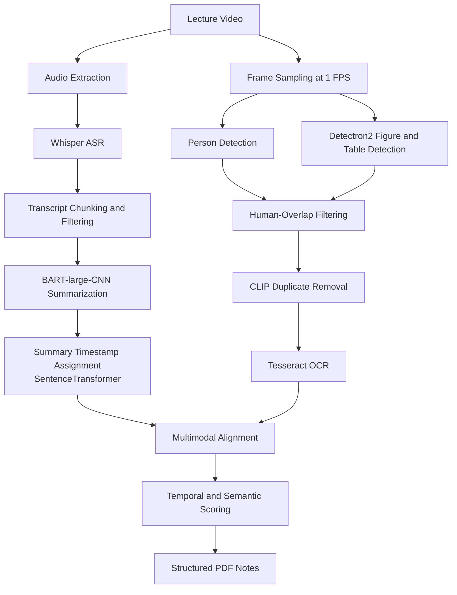

# Multimodal Lecture Note Generation Using Text–Visual Alignment

A Python-based multimodal system that converts recorded educational lecture videos into **structured, visually enriched PDF notes**. It processes the audio and video streams independently, then aligns spoken-content summaries with relevant slide figures and tables using temporal proximity and semantic similarity.

The project includes a **Gradio web interface**, a command-line processing option, and a Kaggle notebook workflow.

## Problem Statement

Recorded lectures communicate information through both speech and visual material such as diagrams, charts, tables, and slide illustrations. Transcript-only tools omit these visuals, while frame-extraction tools do not connect them to the instructor's explanation. Learners are therefore left to manually match spoken concepts with the relevant slide content.

This project addresses that gap by generating notes that combine concise audio summaries with corresponding visual elements.

## Key Features

- **Automatic speech transcription:** Extracts mono, 16 kHz audio from the input video and transcribes it with OpenAI Whisper (base), retaining timestamped segments.
- **Abstractive audio summarization:** Divides transcripts into manageable chunks and generates concise summaries using BART-large-CNN.
- **Timestamp assignment:** Uses SentenceTransformer embeddings to associate each summary with the most semantically relevant transcript segment.
- **Visual element extraction:** Samples video frames at one frame per second and detects figures and tables using a fine-tuned Detectron2 Faster R-CNN R50-FPN model.
- **Instructor-overlap filtering:** Uses a COCO-pretrained person detector and Intersection over Union (IoU) filtering to discard visual crops that overlap detected people.
- **Duplicate removal:** Uses CLIP ViT-B/32 embeddings and cosine similarity to remove repeated or near-identical visual crops.
- **OCR-based text extraction:** Applies Tesseract OCR to detected visual elements to capture text that can support alignment.
- **Multimodal alignment:** Matches each summary with a candidate visual element using a weighted combination of temporal proximity and OCR-text semantic similarity.
- **PDF note generation:** Produces a structured PDF with summarized lecture content and its associated visual elements.
- **Gradio interface:** Provides a browser-based interface for submitting a lecture video and generating notes.

## System Architecture

The pipeline has two parallel processing streams that meet at the multimodal alignment stage:



### Alignment Strategy

For each summary segment, the midpoint of its start and end timestamps is calculated. Visual elements within a **30-second window** are considered as candidates. The system combines temporal relevance and semantic similarity using:

`Alignment Score = 0.7 × (1 − d/30) + 0.3 × similarity`

where `d` is the absolute time difference between the summary midpoint and the visual element timestamp, and `similarity` is the cosine similarity between the summary embedding and the OCR-text embedding. If a visual element has no OCR text, its semantic similarity is set to zero.

## Models and Technologies

| Component | Model / Technology | Purpose |
|---|---|---|
| Audio extraction | FFmpeg | Extracts and preprocesses lecture audio |
| Speech recognition | Whisper base | Timestamped speech transcription |
| Audio summarization | BART-large-CNN | Abstractive transcript summarization |
| Text embeddings | SentenceTransformer `all-MiniLM-L6-v2` | Timestamp matching and semantic alignment |
| Layout detection | Detectron2 Faster R-CNN R50-FPN | Detects slide figures and tables |
| Person detection | COCO-pretrained Faster R-CNN R50-FPN | Filters instructor overlap |
| Visual deduplication | CLIP ViT-B/32 | Removes near-duplicate visual crops |
| Text extraction | Tesseract / pytesseract | Extracts text from detected visuals |
| PDF generation | ReportLab | Creates structured PDF notes |
| User interface | Gradio | Video upload and note-generation interface |

**Core stack:** Python, PyTorch, Hugging Face Transformers, OpenAI Whisper, Detectron2, OpenAI CLIP, Sentence Transformers, OpenCV, Tesseract OCR, ReportLab, and Gradio.

## Project Structure

```text
lecture-summarizer-with-visuals/
├── app.py              # Complete processing pipeline and Gradio application
├── notebook.ipynb      # Kaggle notebook implementation
├── requirements.txt    # Python package dependencies
└── README.md
```

Generated files are written to the `outputs/` directory by default.

## Getting Started

### 1. Clone the repository

```bash
git clone https://github.com/Shanmugharini/lecture-summarizer-with-visuals.git
cd lecture-summarizer-with-visuals
```

### 2. Install system dependencies

Install **FFmpeg** and **Tesseract OCR** and ensure both are available on your system PATH.

On Ubuntu/Debian:

```bash
sudo apt-get update
sudo apt-get install -y ffmpeg tesseract-ocr
```

### 3. Set up Python dependencies

Use Python 3.10 in a virtual environment. Install a compatible PyTorch and TorchVision build for your machine first, following the [official PyTorch installation guide](https://pytorch.org/get-started/locally/).

Then install the project dependencies:

```bash
pip install --no-build-isolation -r requirements.txt
```

Detectron2 installation can depend on the installed Python, PyTorch, CUDA, and compiler versions. If installation fails, use a compatible Detectron2 build for your environment.

### 4. Provide the fine-tuned Detectron2 weights

The application expects the fine-tuned PubLayNet layout-detection checkpoint at `model_final.pth` by default. The checkpoint is not included in this repository.

Obtain the checkpoint separately and set its path with the `WEIGHTS_PATH` environment variable.

Linux/macOS:

```bash
export WEIGHTS_PATH="/path/to/model_final.pth"
```

Windows PowerShell:

```powershell
$env:WEIGHTS_PATH = "C:\path\to\model_final.pth"
```

### 5. Run the application

Launch the Gradio interface:

```bash
python app.py
```

To create a temporary public Gradio share link:

```bash
python app.py --share
```

To process a video directly without opening the interface:

```bash
python app.py --video lecture.mp4
```

The system automatically uses CUDA when available; otherwise it runs on CPU. A CUDA-enabled GPU is strongly recommended because the pipeline loads multiple deep-learning models.

## Run Using Kaggle

The repository also includes `notebook.ipynb` for running the pipeline in Kaggle.

1. Upload or import the notebook into Kaggle.
2. Enable **GPU** under Notebook Settings and enable Internet if model downloads are required.
3. Add the lecture video as a notebook input.
4. Add the fine-tuned Detectron2 checkpoint as a notebook input.
5. Update the video and checkpoint paths in the notebook to match the Kaggle input paths.
6. Run the notebook cells in order.
7. Download the generated PDF and other output files from the Kaggle working directory.

## Output Files

The application writes generated results to the configured working directory (default: `outputs/`).

| Output | Description |
|---|---|
| `final_notes.pdf` | Structured lecture notes containing summaries and aligned visuals |
| `module1_output.json` | Audio summaries with timestamps |
| `module2_output.json` | Detected visual elements, timestamps, and OCR text |
| `module3_output.json` | Summary-to-visual alignment results |
| `crops/` | Extracted figure and table image crops |

## Results and Evaluation

The system was evaluated on a collection of lecture videos across multiple subject areas. The reported results include:

| Evaluation area | Reported result |
|---|---|
| Detectron2 visual detection | mAP: **61.96%**; AP50: **80.27%** |
| Audio summarization | ROUGE-1: **0.4038–0.5979** |
| Audio summarization | BERTScore: **0.8373–0.8770** |
| CLIP-based visual deduplication | Deduplication rate: **0.9086–0.9767** across lecture videos |
| Multimodal alignment | F1-score: **0.5455–0.8889** across evaluated videos |

These figures are evaluation results from the project experiments; performance may vary with lecture quality, video layout, audio clarity, and hardware.

## Limitations

- The layout detector currently retains **figures and tables**; other elements such as titles, bullet lists, equations, and code blocks are not included in the final visual extraction stage.
- OCR quality can decrease for small text, complex diagrams, unusual fonts, or low-resolution frames.
- Incorrect or noisy speech transcription can affect the generated summaries and subsequent alignment.
- The current alignment method uses a fixed 30-second candidate window and fixed temporal/semantic weights.
- Processing is computationally intensive, and a GPU is recommended.
- The fine-tuned Detectron2 checkpoint must be supplied separately.

## Future Scope

- Extend visual extraction to equations, code blocks, lists, and additional slide structures.
- Adapt alignment weights dynamically to lecture pacing and slide transitions.
- Improve OCR and handling of complex diagrams.
- Support longer lecture videos and multilingual transcription.
- Explore cloud deployment for broader access.

## Acknowledgement

Developed as the **CS6811 Final Year Project** at **Madras Institute of Technology, Anna University**.

**Project title:** Multimodal Lecture Note Generation Using Text–Visual Alignment
